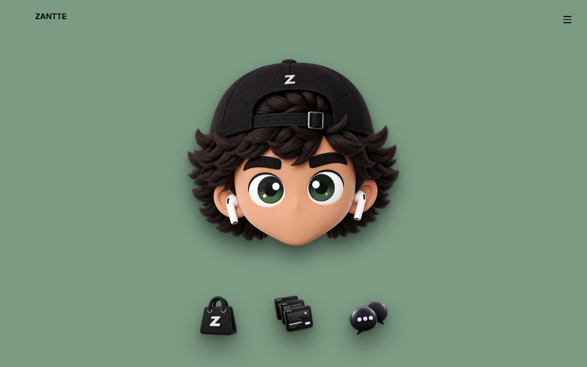
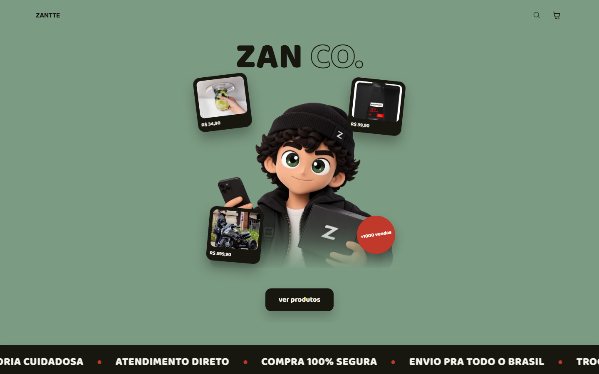

# Zantte

**Site e loja da Zantte**, minha empresa de IA, sistemas, sites e 3D. Inclui a **Zan Co.**, a loja da Zantte, com catálogo, carrinho, frete, pagamento e painel de administração próprios.

No ar em **[zantte.com.br](https://zantte.com.br)** · Instagram [@zanttebr](https://instagram.com/zanttebr)



## O que tem no site

- **Página inicial** quase sem texto: o mascote 3D da marca e um menu de ícones 3D (loja, portfólio, contato).
- **Portfólio, Sobre e Contato** da empresa.
- **Zan Co., a loja:**
  - catálogo com busca e página de cada produto;
  - carrinho com cálculo de frete pelo Melhor Envio;
  - pagamento pelo Mercado Pago, com confirmação automática por webhook;
  - página de acompanhamento do pedido e e-mail para o cliente (Resend);
  - páginas de dúvidas e termos.
- **Painel de administração**, com login próprio:
  - produtos e projetos do portfólio, com upload de imagens;
  - pedidos e o status de cada um;
  - fluxo de caixa num calendário.



## Stack

| Parte | Tecnologia |
| --- | --- |
| Site | Next.js 16 (App Router), React 19, TypeScript, Tailwind CSS 4 |
| Animação e 3D | GSAP e Three.js |
| Banco | Postgres na Neon |
| Imagens | Vercel Blob |
| Pagamento e frete | Mercado Pago e Melhor Envio |
| E-mail | Resend |
| Login do painel | sessão assinada com `jose` |
| Hospedagem | Vercel |

## Rodando localmente

```bash
npm install
npm run dev
```

Copie `.env.example` para `.env.local` e preencha as chaves: banco, Vercel Blob, Mercado Pago, Melhor Envio, Resend e a senha do painel. Nenhuma chave fica no repositório.

---

Feito por [Daniel Dazevedo](https://dazevedo.dev) · DAZEVEDO
